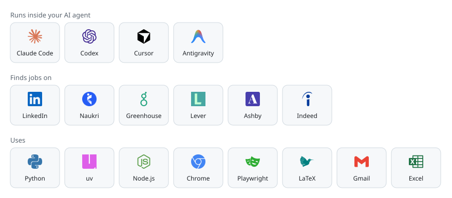

# The Jobfather

The Jobfather is a job-search assistant that runs inside the AI agent you already use: Claude Code,
Codex, Cursor or Antigravity. It learns your background from your own CV, works out which job titles
and keywords your field really uses, finds jobs that fit, writes a one-page CV and an application in
your voice for each one, and keeps track of the replies. It works for any field and any region, and
nothing is sent or submitted until you approve it.


<picture>
  <source media="(prefers-color-scheme: dark)" srcset="docs/works-with-dark.svg">
  
</picture>

## Why I built it

I'm Tushar Sapra. I work in marketing, and I use The Jobfather in my own job search. It started as a
private skill for my hunt: it began with marketing roles, and over time it learned which titles and
keywords found the right jobs, which openings to skip, and how I write. I rebuilt it so you can set
it up with your own details and get the same help. None of my personal data is in this repository.

## How it works

1. Set it up once: give it your CV, your LinkedIn data export and a few emails you've written. It
   drafts your profile from those facts and asks short questions to fill the gaps.
2. It maps your job market by reading live job posts for your field and region, and learns the
   titles, keywords and skills employers ask for, and which ones to skip.
3. Then it finds jobs on company career pages, LinkedIn and Naukri, reads each job ad in full,
   checks how well it fits your experience, and keeps everything in one tracker you can edit.
4. For each job you pick, it writes a one-page CV tailored to that ad, and the application email,
   cover letter or follow-up, in your own voice.
5. Nothing goes out without your OK. You approve each email or application, and on application
   forms you click Submit yourself.
6. With your mailbox connected, it reads the replies, tells you what needs attention and when to
   follow up, and saves what you teach it so the next search is better.

Everything about you stays in one folder on your computer (`~/Jobfather`).

## The more it knows you, the better it works

Every match, CV and email comes from the facts in your folder, so a thin profile gets generic results
and a full one gets results that fit you. When a fact is missing, it asks. What helps most:

- your full CV, your LinkedIn data export, and a portfolio or GitHub link if you have one
- three or four emails or cover letters you wrote yourself, so it can learn your voice
- the roles, seniority and places you want, and the ones you don't
- skills and tools you have never used, so it stops matching you to jobs that need them
- your answers to the questions application forms keep asking, like notice period

When you correct a fact, edit a draft before sending it, or skip a job and say why, it offers to save
that for next time. Each saved lesson goes into a change log you can read, and any change can be
undone.

## What you need

- An AI agent that supports skills: Claude Code, Codex, Cursor or Antigravity
- Python 3.9 or newer
- For searching sites and filling forms in a browser: [uv](https://github.com/astral-sh/uv),
  Node.js 18 or newer, and Google Chrome
- For CV PDFs: a TeX distribution with pdfLaTeX (TeX Live, MacTeX or MiKTeX) and Poppler

Gmail, LinkedIn and Naukri are optional connections. Setup checks what you have and tells you how to
install the rest.

## Install

### Claude Code

```text
/plugin marketplace add tusharsapra/the-jobfather
/plugin install the-jobfather@the-jobfather
```

### Codex

```bash
codex plugin marketplace add tusharsapra/the-jobfather
codex plugin add the-jobfather@the-jobfather
```

### Antigravity

```bash
git clone https://github.com/tusharsapra/the-jobfather
agy plugin install the-jobfather/plugins/the-jobfather
```

### Any agent that supports skills

```bash
npx skills add tusharsapra/the-jobfather -g -a claude-code   # or -a codex, -a antigravity, -a '*'
```

Then say: **"Set up The Jobfather."**

## Using it

Ask in plain words, for example:

- "Import my CV and LinkedIn export"
- "Which job titles should I be searching for?"
- "Find data analyst jobs posted this week in Toronto"
- "Search Naukri for marketing manager roles from the last three days"
- "Rank my saved jobs" or "What needs my attention?"
- "Tailor my CV for this job" or "Write the application email"
- "Apply to this Greenhouse job" (it fills the form; you click Submit)
- "Remember: I never use 'Dear Hiring Manager'"
- "Undo the last change"

## Your data and your control

- Your profile, CVs, tracker and history stay in your folder. The Jobfather's code stores none of it
  and uploads none of it; the services you connect see only what a task needs.
  [PRIVACY.md](PRIVACY.md) has the details.
- It starts in drafts-only mode. Sending emails and submitting applications are switched on
  separately, and each item still needs your approval, which expires after 15 minutes and works
  once.
- It uses your own accounts in a normal Chrome window. You sign in and type every password and
  security code yourself.
- Facts come from your profile, each with its source, and it ignores instructions hidden inside job
  ads.

## Contributing

See [CONTRIBUTING.md](CONTRIBUTING.md) and [AGENTS.md](AGENTS.md) for how the repository is laid out.
Every commit is scanned for personal data, and the tests use only a fictional demo persona.

## Credits and licence

MIT licence: anyone can use The Jobfather, free, to find a job. See [LICENSE](LICENSE).

Built by Tushar Sapra ([@tusharsapra](https://github.com/tusharsapra)). Third-party work and
licences are listed in [THIRD-PARTY.md](THIRD-PARTY.md). Logos come from
[Simple Icons](https://simpleicons.org) and the brands' own websites; every name and logo belongs to
its owner and appears only to say what The Jobfather works with. The Jobfather is an independent
project with no ties to any of them.
